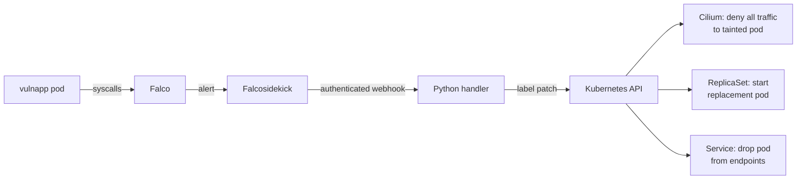

# Kubernetes Runtime Security & Incident Response Lab

[](https://github.com/Gianmarco-Fabbri/Kubernetes-Incident-Response/actions/workflows/ci.yml)
[](LICENSE)

A hands-on lab that detects malicious activity inside a Kubernetes pod at runtime and
responds automatically: the compromised pod is cut off from the network and from its
Service, kept alive for investigation, and replaced by a healthy replica.

It combines [Falco](https://falco.org/) for syscall-level detection,
[Falcosidekick](https://github.com/falcosecurity/falcosidekick) for alert forwarding,
a small Python response handler and [Cilium](https://cilium.io/) network policies.
The project started as a university assignment at Politecnico di Torino and has been
extended since ([project history](#project-history)).

> [!WARNING]
> The Flask target is **intentionally vulnerable** to command injection. Run the lab
> only on a disposable cluster and never expose it to an untrusted network. The target
> Service is a NodePort (`32080`) reachable on every node address: firewall the nodes
> so that only the lab host can reach it. This is a learning environment, not a
> production controller or a forensic acquisition tool.

📄 **[Technical report (PDF)](Kubernetes_Runtime_Security_Guide.pdf)**: design,
deployment and detection scenarios in detail.

## Why

Once an attacker gets code execution in a container they can open a reverse shell,
read the ServiceAccount token or run evasive payloads. Detecting this is only half of
the job: deleting the pod immediately interrupts the service and destroys volatile
evidence, while leaving it running lets the attack continue. This lab explores a
middle ground: **isolate, preserve, replace**.

## How it works



1. Falco matches a suspicious syscall pattern in the `vulnapp` container.
2. Falcosidekick forwards the alert to the handler with a shared token.
3. The handler validates the rule, namespace and target, then patches the pod labels:
   it removes the selector labels (`app`, `pod-template-hash`) and adds
   `tainted-by-falco=true`, a manager label and a UTC quarantine timestamp.
4. Kubernetes and Cilium react to the new labels:
   - the Service stops routing traffic to the pod;
   - the ReplicaSet no longer owns it and starts a fresh replica;
   - a `CiliumNetworkPolicy` denies all ingress and egress for the tainted pod.

### Detection rules

| Falco rule | Scenario |
|---|---|
| `Redirect STDOUT/STDIN to Network Connection in Container` | Reverse shell via command injection |
| `PTRACE anti-debug attempt` | Anti-debugging payload ([`ptrace.c`](material/payloads/ptrace.c)) |
| `Detect Network Tools in vulnapp` | Custom rule: `curl`, `wget`, `nc`… executed in the target |

The report also covers reading the ServiceAccount token as an exposure exercise. It is
not a detection guaranteed by this ruleset.

## Repository layout

| Path | Contents |
|---|---|
| [`material/falco/`](material/falco) | Falco Helm values, custom rule, Falcosidekick ingress policy |
| [`material/falco_handler/`](material/falco_handler) | Response handler, scoped RBAC, network policy, unit tests |
| [`material/manifests/`](material/manifests) | Target Deployment, Service, PDB and Cilium quarantine policy |
| [`material/vulnapp/`](material/vulnapp) | Deliberately vulnerable Flask target |
| [`material/payloads/`](material/payloads) | Linux `ptrace` anti-debugging demonstration |
| [`report/`](report) | LaTeX sources of the technical report |

## Quickstart

### Requirements

- A **disposable** Linux Kubernetes cluster with Cilium as CNI. Do not swap the CNI of
  an existing cluster. The original lab used Cilium 1.15.14; pick a currently supported
  version for new installations and record it.
- Kernel with BTF support (Falco runs with the modern eBPF driver).
- `kubectl`, `helm`, `docker` and `openssl` on the lab host.
- Pinned versions: Falco chart **9.1.0** / Falco **0.44.1**. Direct Python
  dependencies are pinned too; image layers and transitive packages are not locked.

Run all commands from the repository root. The image import below targets a
single-node containerd cluster; adapt it for kind or other runtimes. Build the
`ptrace` payload on Linux, not macOS.

### 1. Deploy the target and the quarantine policy

Install the isolation policy **before** enabling the response.

```bash
kubectl config current-context
docker build -t vulnapp:lab-v2 material/vulnapp
docker build -t falco-handler:lab-v2 material/falco_handler/src
docker save vulnapp:lab-v2 falco-handler:lab-v2 | sudo ctr -n k8s.io images import -
kubectl apply -f material/manifests/isolate-tainted-policy.yaml
kubectl apply -f material/manifests/vulnapp-deployment.yaml
kubectl apply -f material/manifests/vulnapp-service.yaml
kubectl apply -f material/manifests/vulnapp-pdb.yaml
kubectl -n default rollout status deployment/vulnapp
```

### 2. Deploy the handler and Falco

Run this block in a single shell, so the token is shared between the handler Secret and
the Falco values:

```bash
export FALCO_WEBHOOK_TOKEN="$(openssl rand -hex 32)"
kubectl -n default create secret generic falco-handler-auth \
  --from-literal=webhook-token="$FALCO_WEBHOOK_TOKEN" \
  --dry-run=client -o yaml | kubectl apply -f -
kubectl apply -f material/falco_handler/falco-handler-rbac.yaml
kubectl apply -f material/falco_handler/falco-handler-service.yaml
kubectl apply -f material/falco_handler/falco-handler-networkpolicy.yaml
kubectl apply -f material/falco_handler/falco-handler-deployment.yaml
kubectl -n default rollout restart deployment/falco-handler
kubectl -n default rollout status deployment/falco-handler
kubectl create namespace falco --dry-run=client -o yaml | kubectl apply -f -
kubectl apply -f material/falco/falcosidekick-networkpolicy.yaml
helm repo add falcosecurity https://falcosecurity.github.io/charts
helm repo update
(
  umask 077
  FALCO_VALUES_DIR=$(mktemp -d)
  trap 'rm -f "$FALCO_VALUES_DIR/values.yaml"; rmdir "$FALCO_VALUES_DIR"' EXIT
  cp material/falco/falco-values.example.yaml "$FALCO_VALUES_DIR/values.yaml"
  perl -pi -e 's/CHANGE_ME/$ENV{FALCO_WEBHOOK_TOKEN}/g' "$FALCO_VALUES_DIR/values.yaml"
  helm upgrade --install falco falcosecurity/falco --version 9.1.0 \
    --reset-values -n falco -f "$FALCO_VALUES_DIR/values.yaml" --wait
)
unset FALCO_WEBHOOK_TOKEN
```

Notes:

- `--reset-values` drops previous overrides, avoiding duplicate custom rules from
  older installs. Review any local overrides first.
- After changing the token, restart the handler: environment variables from a Secret
  are not refreshed automatically.
- Helm stores the values, token included, in release Secrets. Restrict access to them.

## Testing

Unit tests for the handler:

```bash
python3 -m venv .venv
.venv/bin/pip install -r material/falco_handler/src/requirements.txt
PYTHONPATH=material/falco_handler/src .venv/bin/python -m unittest discover \
  -s material/falco_handler/tests -v
```

## Validation status

[GitHub Actions](.github/workflows/ci.yml) runs on every push and pull request:
handler unit tests (Python 3.11, on the runner and inside the non-root, read-only,
network-less handler image), Python compilation, YAML parsing of all manifests and
both container builds.

The following checks were executed manually on 19 September 2026:

| Check | Result |
|---|---|
| Target smoke test | Form GET and loopback ping POST passed without external network access |
| Helm rendering | Chart 9.1.0 rendered; webhook header and policy selector labels checked |
| Kubernetes standard manifests | Server-side dry-run passed on Kubernetes v1.35.6+orb1; no resources created |
| Cilium isolation / complete Falco response chain | **Not yet validated end-to-end** |

<details>
<summary>End-to-end checklist for a disposable Cilium cluster</summary>

1. Record Kubernetes, kernel, runtime, chart, ruleset and image versions. Check that
   Falco starts without duplicate rules and emits pod/namespace fields.
2. Verify allowed Falco-to-Falcosidekick and Falcosidekick-to-handler traffic; reject
   requests from unrelated pods and unauthenticated webhook calls.
3. Trigger each accepted rule and observe the target labels, EndpointSlice removal
   and recovery to two ready application replicas.
4. Test controlled ingress/egress TCP, UDP/DNS, ICMP and established connections;
   correlate failures with Cilium drop verdicts and check deny precedence over allow policies.
5. Measure service errors/latency and container restart counts during response.
6. Verify RBAC scope, failed-request retries, duplicate events and retention of
   unrelated or unexported evidence. Check behaviour during bursts and handler upgrades.

A failed internet ping alone does not demonstrate bidirectional containment.

</details>

## Design notes and limitations

**Scope.** The handler only acts on the three rules above, for pods in `default`
labelled `app=vulnapp`. Its Role is namespaced, and patches use `resourceVersion` to
detect stale writes.

**Asynchronous enforcement.** A successful label patch does not by itself prove that
traffic is blocked: Cilium, EndpointSlices and ReplicaSets reconcile asynchronously.
Two replicas and a PDB reduce disruption during an incident but do not guarantee zero
downtime.

**Evidence retention.** Quarantined pods are kept alive, and the target has no
liveness probe so it is not restarted. An OOM kill or node failure can still destroy
volatile evidence. `MAX_QUARANTINED_PODS=3` is a soft limit. Cleanup only deletes
older pods that the handler manages and that an operator has marked as exported,
after actually collecting and verifying the evidence:

```bash
kubectl annotate pod <pod> security-lab/evidence-exported=true
```

Deletions use UID and `resourceVersion` preconditions and a 30-second grace period.
Cleanup runs when new events arrive, not periodically, and unexported pods are never
deleted, so keep an eye on resource usage.

**Delivery.** Falcosidekick sends each alert once and never retries, so the handler
absorbs transient problems itself:

- concurrent alerts wait up to `LOCK_WAIT_SECONDS` (default 10 s) for their turn;
- Kubernetes API conflicts (409), throttling (429), server errors and timeouts are
  retried up to three times with backoff, re-reading the pod before each patch;
- a target pod that no longer exists is reported as `gone`;
- if cleanup of old evidence fails after a successful quarantine, the response is
  still 200 with `cleanup: pending`, and the next accepted event retries it.

An alert is lost only when the wait or the retries run out: the handler logs it at
error level and returns 503 or 502. There is no durable queue. A single Gunicorn
process handles one response at a time, with spare threads for the probes. The
Deployment uses the `Recreate` strategy, so upgrades briefly interrupt the handler.
Do not scale it horizontally.

**Trust boundary.** The webhook uses a shared token over plain HTTP, which is a
lab-grade control, not TLS/mTLS. Falcosidekick only accepts traffic from Falco pods in
its namespace (keep `hostNetwork: false`). Cluster administrators, node access and
anyone who can edit pod labels or add allow policies remain trusted.

**The vulnerability is the point.** The `shell=True` command injection in `vulnapp`
is deliberate and must stay in the lab target.

## Project history

The version presented at Politecnico di Torino on 9 September 2026 is tagged
[`v1.0-submission`](../../tree/v1.0-submission). It used a `kubectl`-based handler,
a zipapp target with seccomp profiles and the original packaged payloads. Work done
after the presentation should not be attributed to the submitted version. It
includes:

- a new Flask target and the `ptrace` anti-debugging payload source;
- a handler built on the Kubernetes Python client, with label-based detachment;
- Cilium quarantine policy, PDB and a two-replica target;
- authenticated webhook, namespaced RBAC, evidence retention rules and network
  policies for Falcosidekick and the handler;
- unit tests, CI and an updated technical report.

<details>
<summary>Upgrading from the submitted version</summary>

Applying the new Role does not remove the old cluster-wide bindings. Inspect
`falco-handler-pod-binding` / `falco-pod-manager` and
`falco-handler-deployment-binding` / `falco-deployment-manager`, and remove them only
after confirming nothing else uses them. Verify that the handler cannot patch pods
outside `default`. Pods quarantined by the old handler have no manager metadata and
are deliberately not adopted or cleaned up automatically.

</details>

## Credits and licenses

Developed by **Gianmarco Fabbri** (M.Sc. Cybersecurity Engineering, Politecnico di
Torino).

The code is released under the [MIT License](LICENSE). The technical report is
licensed under CC BY-NC-SA 3.0 and builds on laboratory material created by
Francesco Pizzato, with enhancements by Alex Palesandro, Marco Iorio and Stefano
Galantino. Keep those notices: the MIT license does not relicense third-party
teaching material.
